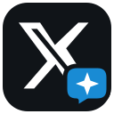

# OnHold 助手

**简体中文** | [English](README.en.md)

## 安装与部署

**首次使用从这里开始：[Skill 安装（AI 引导）](#通过-skill-安装) · [Docker 手动安装](#docker-安装推荐) · [Windows 安装](#windows) · [源码运行](#源码运行)。**

使用支持 Skill 的 Agent 时，先安装 [OnHold Skill](skills/onhold-assistant/SKILL.md)。已有 Node.js 22.20+ 和 npm，可在 macOS / Linux / Windows 终端执行：

```sh
npx skills add OnHoldCC/x-assistant --skill onhold-assistant --global
```

按提示选择你的 Agent，安装后在该 Agent 新开对话，输入：**「使用 onhold-assistant Skill，安装 OnHold 助手。」** 没有 Node.js 时，可直接按下方[让 Agent 安装 Skill](#方式一让-agent-安装-skill)的说明操作。

Skill 会检查 Git / Docker、构建并启动后台，再引导加载插件和连接 X。**安装 Skill 本身不会部署应用**。完成部署后访问 **<http://127.0.0.1:18431/>**；自动发文和回复还需[配置模型](#配置模型)。

Windows PowerShell 命令、环境要求和完整步骤见下方 [Docker 安装](#docker-安装推荐)。[English installation and deployment guide →](README.en.md#installation-and-deployment)

---



在本机运行的 X 账号运营工具：查看账号数据、管理自动化计划、生成和发布内容，并记录每个任务的结果与模型用量。

前端使用 Vue 3 / TypeScript、Soybean Admin 和 Naive UI，后端使用 Rust / Axum / SQLite，通过 Chrome / Edge 插件连接你已登录的 X 账号。

[](https://github.com/OnHoldCC/x-assistant/actions/workflows/verify.yml)

[功能](#功能) · [Skill 安装](#通过-skill-安装) · [Docker 安装](#docker-安装推荐) · [源码运行](#源码运行) · [连接浏览器](#连接浏览器) · [配置模型](#配置模型) · [升级与维护](#升级与维护) · [常见问题](#常见问题) · [许可证](#许可证)

## 功能

- **运营概览**：查看账号指标、各类任务的成功数、失败数和 Token 用量。
- **新闻发文**：从新闻 RSS、微博和小红书热点等来源取材，生成内容并按计划发布；保留来源、跳过原因和发布回执。
- **自动评论与回复**：读取 For You 新帖子或通知中的回复，生成评论并发送，过滤广告、重复及不可用内容。
- **内容工具**：手动改写、生成草稿、定时发布。
- **关系管理**：查看关系名单，按配置执行回关或取关。
- **任务记录**：查看采集、排队、模型生成、发送各阶段，以及失败原因、耗时和模型用量。

自动化需要你创建并启用计划。保存计划后默认暂停；安装完成不会直接开始发帖。

## 安装前准备

选择一种方式安装即可，浏览器连接步骤相同。

| 方式 | 需要准备 | 适用场景 |
| --- | --- | --- |
| Skill（AI 引导） | 支持 Skill、终端与网络操作的 Agent；用 CLI 安装 Skill 时需 Node.js 22.20+ | 让 Agent 检查依赖并执行 Docker 安装、升级与诊断 |
| Docker（推荐） | Git、Docker、Docker Compose v2 | 日常使用，无需在宿主机安装 Node.js、Rust 或 Python |
| 源码运行 | Git、Node.js、Rust、C/C++ 编译工具 | 开发、调试或自行管理后端进程 |

还需要：

- Chrome 120+ 或兼容的桌面版 Edge，以及能正常登录的 X 账号。插件通过开发者模式加载。
- 能访问 GitHub、镜像仓库和依赖源的网络；首次构建会下载依赖，需预留数 GB 磁盘空间。模型调用和新闻取材也需要联网。
- 使用 AI 功能时，另外完成下文的模型配置。基础后台不下载翻译或评分模型。

当前安装流程以**后台、浏览器和 X 登录在同一台电脑**为前提。手机不能加载此桌面插件；远程服务器部署不属于下面的默认安装流程。

## 通过 Skill 安装

仓库内置 [`onhold-assistant`](skills/onhold-assistant/SKILL.md)，供支持 Skill、终端与网络操作的 Agent 使用。它负责检查依赖、拉取源码、执行 Docker 部署、指导插件连接及后续升级。

### 方式一：让 Agent 安装 Skill

将以下完整请求发给你的 Agent：

```text
从 https://github.com/OnHoldCC/x-assistant 安装 skills/onhold-assistant 这个 Skill。
安装完成后告诉我如何启用它。
```

此方式由 Agent 使用自己的 Skill 安装工具处理，不要求你先手动运行 Node.js。安装后在该 Agent 新开对话，发送：

```text
使用 onhold-assistant Skill，安装 OnHold 助手。
```

Agent 必须能够在本机执行终端命令；仅能聊天、不能操作电脑的工具无法完成应用部署。

### 方式二：使用 Skills CLI

先准备 Node.js 22.20+ 和 npm。以下命令适用于 macOS、Linux 和 Windows PowerShell，安装到所选 Agent 的用户级范围，供不同项目使用：

```sh
npx skills add OnHoldCC/x-assistant --skill onhold-assistant --global
```

按提示选择你使用的 Agent，例如 Codex、Claude Code 或 Cursor。只为当前项目安装时，去掉 `--global`。CLI 用法见 [Skills 官方安装说明](https://github.com/vercel-labs/skills#install-a-skill)。

检查用户级安装列表：

```sh
npx skills ls -g
```

确认其中有 `onhold-assistant`，再在所选 Agent 新开对话，输入上面的安装请求。未识别到 Skill 时，检查是否选对 Agent、安装范围及当前项目；必要时重启 Agent 后再试。

### 部署与后续使用

安装 Skill 只添加操作指引，**不会自动启动后台、下载模型或发布帖子**。当你让 Agent「安装 OnHold 助手」后，它会检查或引导准备 Git、Docker 和 Compose，再拉取源码、构建、验证后台并引导连接插件。Docker 首次系统授权、浏览器加载扩展、X 登录和可选 Codex 设备登录需要你完成。

安装成功应看到：后台 `http://127.0.0.1:18431/` 可打开、插件连接到正确账号、首批只读采集任务完成。仅显示「Skill 安装成功」不代表应用已部署。

后续可在同一 Agent 中发送：

```text
使用 onhold-assistant Skill，升级 OnHold 后台和插件。
使用 onhold-assistant Skill，检查 OnHold 后台和插件连接状态。
使用 onhold-assistant Skill，启用 Codex 文章服务并引导我完成登录。
```

Skill 更新和应用更新分别进行。重新执行上面的 `skills add` 命令可安装当前仓库版本的 Skill；后台和浏览器插件仍需执行升级流程。移除 Skill 只移除 Agent 的指引，不会卸载后台或删除账号数据。

## Docker 安装（推荐）

macOS / Windows 先安装并启动 Docker Desktop，Windows 使用 Linux 容器模式；Linux 使用 Docker Engine 与 Compose v2。先在终端确认以下命令能正常运行，Compose 需支持 `up --wait`：

```sh
git --version
docker info
docker compose version
```

安装脚本会从本仓库源码构建镜像、启动后台、检查健康状态，并导出浏览器插件。首次构建时间取决于网络和电脑性能。应用镜像在本机构建，无需寻找预先发布的 OnHold 镜像。

### macOS / Linux

在终端依次执行：

```bash
mkdir -p "$HOME/OnHold"
git clone https://github.com/OnHoldCC/x-assistant.git "$HOME/OnHold/source"
export ONHOLD_INSTALL_DIR="$HOME/OnHold"
bash "$ONHOLD_INSTALL_DIR/source/docker/deploy.sh" install
```

### Windows

在 PowerShell 中依次执行：

```powershell
$env:ONHOLD_INSTALL_DIR = Join-Path $env:USERPROFILE 'OnHold'
New-Item -ItemType Directory -Force $env:ONHOLD_INSTALL_DIR | Out-Null
git clone https://github.com/OnHoldCC/x-assistant.git (Join-Path $env:ONHOLD_INSTALL_DIR 'source')
& (Join-Path $env:ONHOLD_INSTALL_DIR 'source/docker/deploy.ps1') -Action install
```

如果系统策略阻止执行 `.ps1`，可在确认脚本内容后，仅为当前 PowerShell 窗口放行，再执行最后一条命令：

```powershell
Set-ExecutionPolicy -Scope Process -ExecutionPolicy Bypass
```

### 安装结果

出现「部署完成」后，用准备安装插件的 Chrome / Edge 打开：

**<http://127.0.0.1:18431/>**

默认目录如下，Windows 对应 `%USERPROFILE%` 下的 `OnHold`：

```text
~/OnHold/
├── source/       # Git 源码与 compose.yaml
├── extension/    # 浏览器加载这个目录
└── backups/      # 执行备份后生成
```

账号与任务数据保存在 Docker 数据卷中，不在 `source/` 里。`ONHOLD_INSTALL_DIR` 指向安装根目录，保持与 `source/` 分开，避免导出插件时替换 Git 中的 `source/extension/`。

到这里后台已经启动。接下来完成[连接浏览器](#连接浏览器)，需要 AI 发文或回复时再[配置模型](#配置模型)。

希望由 Agent 执行以上步骤时，使用前面的 [Skill 安装方式](#通过-skill-安装)。

## 源码运行

此方式不需要 Docker。先准备：

- **Node.js 24**（与当前前端 CI 一致；根目录要求至少 22.20.0）。
- **Rust 1.94.1 及 Cargo**（与构建镜像一致）。
- 系统 C/C++ 编译工具：macOS 的 Xcode Command Line Tools；Windows 的 Visual Studio Build Tools（C++ 桌面开发）；Linux 的编译工具链，例如 Debian / Ubuntu 的 `build-essential`。

在终端执行，macOS / Linux 和 Windows PowerShell 均可使用以下命令：

```sh
git clone https://github.com/OnHoldCC/x-assistant.git
cd x-assistant
npm --prefix app ci
npm run app:build
cargo run --release --locked --manifest-path backend/Cargo.toml -- --home ./data --assets ./app/dist --port 18431
```

看到后台地址后，打开 **<http://127.0.0.1:18431/>**。后端在当前终端前台运行，按 `Ctrl+C` 停止；日常持续使用需保持进程运行。

- `app:build` 同时生成 `app/dist/` 和插件内的管理界面；完成构建后再加载插件。
- 源码方式加载仓库中的 **`extension/`**，不是 Docker 安装导出的目录。
- 数据默认位于当前仓库的 `data/`，数据库为 `data/onhold-admin.sqlite3`。上面的命令显式固定了数据和页面目录；切换工作目录时请使用对应的绝对路径。
- `node bin/cli.mjs setup` 是旧翻译安装器入口，不能替代这里的 Rust 后台启动命令。

然后继续完成下面的浏览器连接和模型配置。

## 连接浏览器

1. Chrome 打开 `chrome://extensions`，Edge 打开 `edge://extensions`，开启「开发者模式」。
2. 点击「加载已解压的扩展程序」，选择含有 `manifest.json` 的目录：Docker 安装选 `~/OnHold/extension`，源码运行选仓库的 `extension/`。Windows 使用对应安装路径。
3. 在**同一个浏览器配置文件**中打开 <https://x.com/> 并登录你的账号；如果 X 页面早于插件安装已打开，刷新一次页面。
4. 在该浏览器打开 <http://127.0.0.1:18431/>，按初次连接引导操作，或点击右上角连接状态入口，在「账号与模型」中选择「连接 X 助手插件」。地址与密钥自动配对，无需手工复制 Cookie。
5. 确认后台显示正确的 `@账号` 和连接状态，再执行一次账号采集，检查运营概览与任务记录。

插件使用 `debugger` 权限通过 CDP 执行浏览器操作，Chrome 可能显示正在调试的提示。**发帖、评论、回复和关系操作需要浏览器保持运行、插件在线且 X 登录有效**；只看到后台采集在线，不代表浏览器写入连接可用。

## 配置模型

查看数据和管理任务不需要 AI 模型。新闻发文、自动评论、通知回复和「发同款」当前使用 **Codex CLI**；网页里的「自带 API Key」用于支持 API 的手动改写、分析等功能，不能替代这些自动化任务的 Codex 服务。

### Docker 安装：启用并登录 Codex

macOS / Linux：

```bash
export ONHOLD_INSTALL_DIR="$HOME/OnHold"
bash "$ONHOLD_INSTALL_DIR/source/docker/deploy.sh" login
```

Windows PowerShell：

```powershell
$env:ONHOLD_INSTALL_DIR = Join-Path $env:USERPROFILE 'OnHold'
& (Join-Path $env:ONHOLD_INSTALL_DIR 'source/docker/deploy.ps1') -Action login
```

此操作会构建并启动可选的 `agent` 服务，然后执行设备登录。按终端提示打开官方登录链接并输入一次性代码。如果提示设备登录未启用，按 [OpenAI 官方认证说明](https://learn.chatgpt.com/docs/auth) 在账号安全设置或工作空间权限中启用设备代码登录后重试。

**容器内 Codex 与宿主机独立登录**。电脑上已登录 Codex，不代表 Docker 中也已登录。

### 源码运行：安装并登录本机 Codex

在运行后端的同一个系统用户下执行；下面使用与仓库 Docker 构建相同的 CLI 版本：

```sh
npm install -g @openai/codex@0.165.0
codex login
codex login status
```

安装方式另见 [Codex CLI 官方文档](https://learn.chatgpt.com/docs/codex/cli)。后端启动环境的 `PATH` 需要能找到 `codex`；安装后若仍未检测到，重新打开终端再启动后端。

### 在后台完成设置

打开右上角「账号与模型」，选择 Codex CLI，点击「保存模型」和「检查 CLI」。模型名称可留空，使用 CLI 默认值；选择自带 API 时则需要填写地址、接口格式、API Key 和模型名称。

模型请求会使用你的账号额度或 API 余额，失败或跳过的任务也可能产生 Token 用量。模型生成完成与 X 发布成功是两个阶段，是否发送成功应查看任务记录中的发送结果与回执。

当前阅读和发帖主流程不依赖本地翻译或评分模型。Docker 中保留了兼容用途的 `translation` 选项，按需安装会额外下载约 1.91 GB 的 Hy-MT2 权重；首次使用无需启用，详见 [Docker 说明](docs/DOCKER.md)。

## 启动自动化

1. 在「自动化任务配置」中新建计划，选择账号与任务类型，例如新闻发文、For You 自动评论或通知回复。
2. 设置语言、间隔、单轮数量与每日上限；新闻发文还需选择来源并填写主题。
3. 保存后先核对配置，再点击「启用」。先使用小额度，确认首轮的采集、模型和发送结果。
4. 在「任务记录」查看详情，在「运营概览」查看各任务成功数、失败数和累计 Token 用量。

新闻计划可选择每 1 分钟执行，实际执行还受任务耗时、排队和每日上限影响。同账号的浏览器动作串行执行；没有可用新内容、来源失败或核实未通过时会记录原因并跳过，不保证每轮都能发出帖子。

## 升级与维护

### Docker 日常操作

每次打开新终端，先设置安装根目录。macOS / Linux：

```bash
export ONHOLD_INSTALL_DIR="$HOME/OnHold"
bash "$ONHOLD_INSTALL_DIR/source/docker/deploy.sh" status
bash "$ONHOLD_INSTALL_DIR/source/docker/deploy.sh" verify
```

Windows PowerShell：

```powershell
$env:ONHOLD_INSTALL_DIR = Join-Path $env:USERPROFILE 'OnHold'
& (Join-Path $env:ONHOLD_INSTALL_DIR 'source/docker/deploy.ps1') -Action status
& (Join-Path $env:ONHOLD_INSTALL_DIR 'source/docker/deploy.ps1') -Action verify
```

将最后的操作名替换为下表中的值即可：

| 操作 | 行为 |
| --- | --- |
| `status` | 查看容器状态 |
| `verify` | 检查后台与已启用的翻译服务 |
| `start` | 从当前源码重新构建、启动、验证，并导出插件 |
| `stop` | 停止服务，保留数据和模型 |
| `backup` | **先停止服务**，再将私有数据备份到 `backups/`；完成后保持停止 |
| `login` | 启用 Codex 服务并进行设备登录 |

`verify` 不代表模型已登录或能完成发帖，模型状态还需在网页点击「检查 CLI」。查看后台日志，在 `source/` 目录执行：

```sh
docker compose --project-name onhold logs --tail=100 -f web
```

按 `Ctrl+C` 结束看日志，不会停止容器。Codex 服务日志可将 `web` 换为 `agent`。

### 更新代码与插件

先暂停自动化并等待正在发送的任务结束，再用**旧版本脚本备份**、拉取代码、用新版本启动。以下假设沿用默认目录和当前分支；本地有修改时先自行保存和处理，不要强制覆盖。

macOS / Linux：

```bash
export ONHOLD_INSTALL_DIR="$HOME/OnHold"
bash "$ONHOLD_INSTALL_DIR/source/docker/deploy.sh" backup
git -C "$ONHOLD_INSTALL_DIR/source" pull --ff-only
bash "$ONHOLD_INSTALL_DIR/source/docker/deploy.sh" start
```

Windows PowerShell：

```powershell
$env:ONHOLD_INSTALL_DIR = Join-Path $env:USERPROFILE 'OnHold'
& (Join-Path $env:ONHOLD_INSTALL_DIR 'source/docker/deploy.ps1') -Action backup
git -C (Join-Path $env:ONHOLD_INSTALL_DIR 'source') pull --ff-only
& (Join-Path $env:ONHOLD_INSTALL_DIR 'source/docker/deploy.ps1') -Action start
```

每一步成功后再执行下一步。单独 `git pull` 不会更新运行中的容器；`start` 会重新构建并更新固定插件目录。`upgrade` 操作会备份并重建当前源码，**不会替你拉取 Git 更新**。

完成后在原 Chrome / Edge 打开 <http://127.0.0.1:18431/#/connect?upgrade=1>，按提示更新连接。运行中的旧插件不支持自动重载时，在扩展管理页手动点击「重新加载」。涉及 X 页面脚本更新时，先保存未发送草稿，再刷新 X 页面，确认实际连接版本与账号。

源码方式更新时，先停止后端并备份整个 `data/`（包含可能存在的 SQLite WAL 文件），再拉取代码，重新执行 `npm --prefix app ci`、`npm run app:build` 和后端启动命令，然后重载插件。

### 数据保存

Docker Compose 项目名固定为 `onhold`：

| 数据卷 | 内容 |
| --- | --- |
| `onhold_state` | 账号、任务、配置、缓存及可选 Codex 登录数据 |
| `onhold_secrets` | 内部服务密钥 |
| `onhold_models` | 可选翻译模型权重，启用后才创建 |

`backup` 备份的是 `state` 中的私有数据，不包含模型权重和独立的 `secrets` 卷。备份内有账号会话和模型认证信息，应私密保存。需要恢复或迁移旧安装时，参阅[维护与恢复说明](skills/onhold-assistant/references/docker.md)，不要覆盖已有数据库或直接复制仍在写入的 SQLite 主文件。

`stop` 和普通 `docker compose down` 保留数据卷。**不要使用 `down -v` 或删除数据卷来解决一般故障**，这会删除账号、任务历史或认证数据。当前安装流程不自动迁移旧桌面版数据。

## 常见问题

| 现象 | 检查与处理 |
| --- | --- |
| Docker 引擎未就绪 | 启动 Docker Desktop，等待 `docker info` 成功；Linux 确认当前用户能使用 Docker。 |
| 下载或构建失败 | 找到日志中失败的镜像、npm 或 crates 源，检查网络和磁盘；修复后重试安装，构建缓存会保留。 |
| `18431` 被占用 | 检查是否已有源码版、桌面版或另一份 OnHold 后台；先确认所属进程，再停止旧服务。默认不同时运行两种安装方式。 |
| 后台打开空白或页面不存在 | 源码方式先完成 `npm run app:build` 并核对 `--assets` 目录；Docker 方式查看 `web` 日志和健康检查。 |
| 未检测到插件 / 一直等待连接 | 核对加载目录含 `manifest.json`，后台与 X 使用同一浏览器配置文件，重载扩展、刷新 X 后重新连接。 |
| 模型服务未启用 / 未登录 | Docker 执行 `login`，源码运行执行 `codex login`；回到网页保存模型并检查 CLI。 |
| X 回复输入框未就绪 | 确认浏览器在线、X 未退出或弹出验证，等待页面加载后再检查任务；查看具体失败详情，避免连续盲目重试。 |
| 显示跳过且没有发帖 | 展开任务日志，检查候选为空、重复、来源不可用或核实失败等具体原因；Token 消耗不表示帖子已经发出。 |
| 手机 / 其他电脑打不开本机地址 | `127.0.0.1` 仅指当前设备；默认安装仅供本机使用，不提供直接对公网开放的配置。 |

后台健康地址为 <http://127.0.0.1:18431/health>，可查看服务版本、构建 commit 和内置插件版本。需要反馈问题时，请附操作系统、安装方式、上述版本和已脱敏的失败阶段日志，不要提交 Cookie、配对密钥、API Key 或 Codex 登录凭据。

## 开发与项目结构

```text
app/                         Vue 前端与 Tauri 桌面壳
backend/                     Rust / Axum / SQLite 后台
extension/                   Chrome / Edge 插件
compose.yaml                 Docker Compose 服务定义
docker/                      镜像构建和部署脚本
skills/onhold-assistant/     Agent 安装与维护 Skill
lib/、bin/                   旧翻译安装器及兼容工具
docs/                        设计、部署与业务说明
test/                        Node 测试与浏览器夹具
```

在已准备源码运行环境后，常用检查命令如下：

```sh
npm test
cargo test --locked --manifest-path backend/Cargo.toml
npm run app:build
```

`npm run ui:dev` 启动前端开发服务，组件规范页面为 `http://127.0.0.1:1420/ui.html`。完整业务使用上文 Rust 后台提供的 `18431` 页面；单独启动 Vite 不会启动后端，也不会自动配对。

桌面版基于 Tauri 2，另有平台构建依赖和离线资源要求，详见[桌面构建说明](docs/DESKTOP.md)。旧离线包见[离线分发说明](docs/OFFLINE-RELEASE.md)；这些不属于推荐 Docker 安装所需步骤。Android / iOS 尚未交付可用安装包。

## 更多文档

- [Docker 部署说明](docs/DOCKER.md)与[维护、更新及恢复](skills/onhold-assistant/references/docker.md)
- [自动化与运营口径](docs/OPERATIONS-0.9.md)、[新闻来源与核实](docs/NEWS-SOURCES.md)
- [后台采集与登录态存储](docs/BACKEND-CAPTURE.md)、[账号指标说明](docs/X-OPERATIONS-METRICS.md)
- [UI 设计规范](docs/ONHOLD-UI.md)、[更新日志](docs/RELEASE-0.9.5.md)

## 许可证

本项目采用 [OnHold 助手源码可用许可证 1.0](LICENSE)：允许免费使用、研究、修改与免费分发，也允许个人和企业运营自己的商业账号。未经作者另行书面授权，禁止转售软件、付费分发或向第三方收费提供软件功能。分发和修改版本需保留许可、作者及官方来源说明。

**这是定制的源码可用许可，不是 OSI 批准的开源许可证。** 第三方代码、字体、运行时与模型遵循各自许可证，见[第三方声明](THIRD_PARTY_NOTICES.txt)。

## 作者

**OnHoldCC** · [X · @OnHoldCC](https://x.com/OnHoldCC) · [Telegram · @On_Hold_CC](https://t.me/On_Hold_CC)
