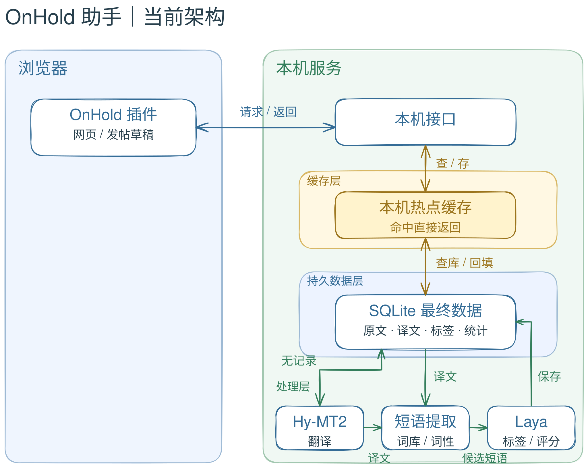

# OnHold 助手


React + TypeScript / shadcn/ui 运营后台，Rust 数据服务，配套 CDP 浏览器插件与本机翻译。

[](https://github.com/OnHoldCC/x-assistant/actions/workflows/verify.yml)

[功能](#功能) · [安装](#安装) · [系统架构](#系统架构) · [维护](#维护) · [许可证](#许可证) · [作者](#作者)

## OnHold UI

[设计规范](docs/ONHOLD-UI.md) · [组件入口](app/src/components/onhold/index.ts) · [0.9 运营口径](docs/OPERATIONS-0.9.md)

基于 shadcn/ui 沉淀的 OnHold 组件与语义主题，供后台、安装引导和插件弹窗复用。执行 `npm run ui:dev`，打开 `http://127.0.0.1:1420/ui.html` 查看组件规范。

## 功能

- **网页互译**：默认将外语译成简体中文，可切换目标语言。
- **逐段展示**：按段落排队翻译，完成一段就显示一段，保留原文。
- **白名单**：按 URL 控制自动翻译，也可以一键加入当前网站。
- **广告风散**：蓝色选中到标记为 Ad、Promoted、广告或推广的帖子时，先停留 1.5 秒，再用约 0.45 秒吹散效果收起空位。屏幕外直接隐藏；减少动态效果时保留静态停留、跳过动画。关闭过滤会恢复广告并停止后续隐藏操作。正文提到广告、作者名称与引用内容不会作为广告标记。
- **自动翻译衔接**：优先使用 X/Grok 已显示且满足阅读目标的译文；“Show translation”入口本身不算译文。原生翻译迟到时短暂等待，仍未译出或中文阅读时仍为外文则本机补漏，不自动点击“显示原文”。
- **X 草稿一键翻译**：直接在 X 原输入框写正文，最后一行下方显示“译为 · 目标语言 · 一键翻译”；点击后替换当前草稿，支持撤销，不自动发布。
- **帖子边框摘要**：一行异色小字靠右显示在当前帖子上边框，点击详情展开右侧明细，可收起；草稿不请求评分或改写。
- **账号数据**：右上角插件统一展示本人 Analytics、创收达标进度与30天收益估算；未开通显示大号 ¥0，毕业后隐藏资格进度，保留账号、周期、来源与读取时间。加权互动率使用（0.66×赞＋5×评＋转）÷曝光×100%，标为参考，并与 X 官方互动率分开。
- **本机状态**：显示翻译数量、平均推理耗时、本程序 CPU、内存与数据占用。

插件新增的翻译由本机模型处理，不调用云端翻译 API；X 自身显示的译文来自 X 的原生功能。输入框、代码块和独立 `@账号` 引用跳过阅读翻译。插件不会替你自动发布帖子。

## 安装

### 多端管理后台（0.9.0）

主界面为运营概览、内容复盘、我的收藏、账号管理、自动化、系统日志和作者页。连接与模型配置从右上角状态灯打开。前端以 shadcn/ui 与 Radix 作为交互底座，使用 OnHold 自己的运营组件与桌面布局，后端由 Rust / SQLite 管理快照、连接与任务，Tauri 2 承载桌面和移动端。0.7.0 的 Electron 模型控制台原型已退出主流程。

Mac 更新优先使用 PKG 覆盖安装包，固定替换应用程序目录中的 OnHold Admin，旧 0.7.0 原型备份保留。

桌面打包默认校验并附带 **Hy-MT2、Laya 及现有离线运行环境**；统计后台可独立使用，不因模型未加载而阻止查看数据。已有翻译安装器及模型工作进程保留兼容。手机端模型内置与离线推理尚未完成，不能用桌面运行时宣称支持手机推理。

- 先执行 `npm --prefix app ci`、`npm run app:build`、`npm run desktop:start`。
- 按「安装 → 连接 → 完成」引导在 Chrome / Edge 加载助手，地址与密钥自动配对。
- 新版插件连接时通过 CDP 读取登录凭证、学习当前账号的只读接口，由 Rust 后台每 5 分钟获取资料和本人帖子，关闭浏览器后仍继续。凭证失效后暂停并提示重新连接；账号页「断开采集」清除凭证并保留历史数据。旧插件仍使用原浏览器采集流程。
- 官方分析与创作者数据仅接受已支持的接口结构；未识别时保留上次数据并显示失败原因。接口适配范围、登录态存储及验证步骤见 [后台采集说明](docs/BACKEND-CAPTURE.md)。
- 移动界面支持 HTTPS 连接 Rust 服务；Chrome/Edge 桌面插件不会在手机 Chrome 中运行。

已通过 Rust 统计/任务测试、真实 CDP 夹具联动、密钥/来源校验及 375/768/1320 布局检查。Android 缺少 SDK/NDK，iOS 缺少完整 Xcode/CocoaPods 与签名配置，尚未生成 APK/IPA。构建方法与限制见 [多端打包说明](docs/DESKTOP.md)。

### 环境要求

| 项目 | 要求 |
| --- | --- |
| 浏览器 | Chrome 120+ 或兼容的 Edge |
| Node.js | Skill 自动检测；缺少合适版本时自动安装独立 Node.js |
| 磁盘空间 | 首次安装至少预留 8 GiB |
| 翻译模型 | Hy-MT2-1.8B GGUF Q8_0，约 1.91 GB，首次需要翻译时下载 |
| 评分模型 | Laya 多语版，下载约 678 MB |
| 系统 | macOS / Windows；Mac 优先 Metal；Windows 检测可用 GPU，失败时回退 CPU |

Mac Apple Silicon 已完成本机模型实测。Mac / Windows 自动化测试均已通过；Windows 真机模型运行、Intel Mac 和全新机器下载流程尚未完整实测。

Skill 自动准备 Node.js，再由安装器准备模型运行环境，无需手动安装 Node.js、Python、Docker 或 Ollama。已有合适的 Node.js 会直接复用；独立 Node.js 不覆盖系统版本，也不修改全局 PATH。

### 方式一：通过 Skill 安装

在已经安装 Skill 的 Agent 中，直接说：

```text
安装 OnHold 助手
升级 OnHold 助手
卸载 OnHold 助手
把翻译模型换成这个：[模型链接]
```

首次使用时，将以下请求交给支持 Skill 与终端操作的 Agent：

> 从 https://github.com/OnHoldCC/x-assistant 安装 skills/onhold-assistant。使用该 Skill 自动检测并安装 Node.js，部署插件和本机翻译、评分模型，完成后检查服务状态。

已有 Node.js 时，也可以先用以下命令安装 Skill：

```sh
npx skills add OnHoldCC/x-assistant --skill onhold-assistant
```

Skill 支持安装、升级、卸载、替换兼容模型和诊断。安装 Skill 本身不会立即下载或运行模型；执行安装任务时才会引导 Node.js 和模型依赖。

### 离线安装

离线包按系统和处理器架构分别构建，包含独立 Node.js、Python、运行时、模型和全部依赖 wheels，不包含用户数据。下载并解压对应离线包后，将其目录交给 Agent 执行安装；不需要单独安装 llama.cpp。

离线安装建议预留 16 GiB 可用空间，以容纳下载分卷、临时解压文件和最终安装。

维护者可以从已验证的默认模型安装生成离线目录：

```sh
node bin/build-offline.mjs --home /path/verified-install --output /path/new-offline-bundle
node bin/pack-offline.mjs --bundle /path/new-offline-bundle
```

此命令需要在目标平台上运行。离线包使用 `install.command`（Mac）或 `install.ps1`（Windows）作为入口；缺少或损坏的离线资产会明确报错，不自动转为联网安装。完整离线包及各平台实际测试状态以 GitHub Releases 的说明为准。

打包器生成每份不超过 1.5 GiB 的分卷及校验、自动还原安装入口。用户只需下载同一平台的全部分卷和入口文件，交给 Agent 安装。模型不进入 Git 历史。推送 `v*` 版本标签会触发 Mac / Windows 离线构建与实际推理测试；两端通过后才公开 Release。详细步骤见 [离线分发说明](docs/OFFLINE-RELEASE.md)。

### 方式二：从仓库运行

此方式需要已有 Git 与 Node.js 22.20+；希望自动准备 Node.js 时使用上面的 Skill 流程。

```sh
git clone https://github.com/OnHoldCC/x-assistant.git
cd x-assistant
node bin/cli.mjs doctor
node bin/cli.mjs setup --no-open
```

安装器默认只下载 Laya 决策模型并校验 SHA-256、启动本机服务，输出扩展目录。翻译模型及 llama.cpp 在首次需要本机翻译时才下载和加载；已有模型复用，缓存译文无需唤醒翻译模型。下载或加载失败可重试，GPU 翻译启动失败回退 CPU。llama.cpp 是自动下载的内部运行时，用户不需要单独安装。

### 方式三：使用本地 npm 包

```sh
npx --yes --package ./onhold-assistant-0.8.0.tgz onhold-assistant setup --no-open
```

当前尚未发布到 npm 注册表，`npx onhold-assistant` 还不能作为公开安装命令使用。

### 加载浏览器插件

1. 打开 `chrome://extensions` 或 `edge://extensions`。
2. 开启开发者模式，选择“加载已解压的扩展”。
3. 选择安装器输出的扩展目录。
4. 点击工具栏的 **X + 蓝色助手气泡** 图标，在设置中保存并允许访问本机服务。

首次加载需要浏览器确认，安装器不会修改你的浏览器个人资料。

## 使用

### 自动翻译网页

阅读翻译只按原文真实换行分段；@账号、链接与标点保留在原句内。原文空行保留，模型推理分块不增加显示段落，缓存与耗时每条内容只显示一次。

1. 打开需要翻译的网页。
2. 点击插件图标，选择“将当前网站加入自动翻译”。
3. 允许该网站权限，在插件设置中确认目标语言。

此按钮只加入当前协议、域名和端口的所有路径，不包含子域名。也可以手动设置更窄的 URL 路径，例如：

```text
https://x.com/home
https://x.com/*/status/*
https://example.com/articles/*
```

工具栏状态页底部提供等宽的“刷新状态”和“恢复当前页”按钮。更新后原页面连接失效时，点击“恢复当前页”重新加载网页；检测到未保存的正文或表单输入时会保留当前页并提示先保存。该操作不会再次重载扩展、导致其他标签页断开。

### 翻译草稿

- 发帖或评论时，直接使用 X 原输入框；有文字后，下方出现紧凑的目标语言与“一键翻译”，没有侧栏、Tab 或额外输入框。
- 默认英语，也可在这一行切换目标语言；仅点击按钮才调用本机模型，不在输入或选字时计算评分。
- 译文直接替换当前草稿，“撤销翻译”恢复替换前版本，撤销不请求模型。
- 请求期间修改正文、切换语言或关闭草稿翻译时，迟到的结果不会覆盖输入；中文输入法选字期间不能替换。
- 主帖和评论框分别绑定，私信不处理；翻译与撤销从不点击发布按钮。
- 草稿最多支持 4,000 字符，保留原文真实换行。输入框未完整接受译文时会提示核对或撤销。

0.6.9：草稿只保留翻译与撤销。浏览帖子边框外上方靠右，仅显示帖子评分和参考加权互动率，点击详情展开右侧明细，再点收起折回；摘要独立留出一行空间，不覆盖上条帖子；只有明确点击评分或展开详情才请求内容参考分。账号 Analytics 与创作者状态在右上角插件的 X 数据页统一刷新。定时学习采集仍停止，已有数据保留。

## 系统架构

[项目功能目录、性能优化与升级兼容](docs/PROJECT-STRUCTURE.md) 说明前后端分层、已落实的优化、后续性能重点及数据库/接口兼容规则。

0.6.0 的反馈闭环、参考学习、数据条件和限制见[帖子曝光学习架构](docs/EXPOSURE-LEARNING.md)。下面的图只展示基础请求与缓存链路。



[下载可编辑的 Excalidraw 源文件](docs/architecture.excalidraw)

### 一次请求如何处理

1. 插件将正文交给本机接口。
2. 先查本机内存缓存，命中后直接返回。
3. 内存未命中时查 SQLite；查到后回填内存。
4. 没有记录时调用本机模型，完成后保存结果并回填内存。
5. 自动翻译长帖时先翻译当前显示部分并明确标注；点击 X 的“显示更多”后继续翻译展开内容。手动翻译仍可补读全文。正文翻译优先于排队中的评分辅助翻译，正在翻译的帖子暂缓评分。
6. 推文分析需要中文时先交给 Hy-MT2，再提取候选短语，由 Laya 筛选标签和计算内容参考分。
6. 推荐改写通过独立的 `/rewrite` 接口和独立缓存命名空间生成。采纳发生在浏览器中，不再次调用接口。数字、链接、账号及话题发生增删时拒绝该改写结果，语义事实仍需用户核对。

### 缓存与持久数据

| 层 | 内容 | 保留规则 |
| --- | --- | --- |
| 浏览器 | 设置、迁移标识、页面临时展示状态 | 不持久缓存译文或标签 |
| 本机内存 | 最近使用的译文与分析结果 | 7 天有效，最多 2,000 项 / 32 MiB；重启即清空 |
| 本机 SQLite | 原文版本、译文、标签、来源、可见互动快照、翻译统计 | 不因内存缓存超限而删除 |

原文可以通过平台与 Post ID、URL 或内容指纹定位。译文与分析结果还包含目标语言、模型和流程版本索引。

原文修改时保留历史版本；分段译文关联回来源帖子。不同模型或提示版本不会混用旧结果。默认草稿原文不存成帖子记录，生成的译文、改写和评分可以保存在本机结果层。明确开启账号学习后，会为训练保存该账号的原稿、发布前特征和已关联结果。

### 资源统计

| 指标 | 统计范围 |
| --- | --- |
| 平均耗时 | 模型实际推理耗时，不含缓存命中 |
| CPU | 本机接口、翻译模型和评分模型进程；单核心满载为 100% |
| 内存 | 上述本程序进程的 RSS 合计 |
| 数据占用 | 浏览器设置与 SQLite / WAL / SHM；不含模型、运行时和下载缓存 |

资源面板不显示 GPU 使用率；模型名称旁显示实际使用的推理后端。Windows 翻译优先尝试 Vulkan（可覆盖兼容的独显和核显），Laya 根据可用的 PyTorch 后端选择 CUDA、Intel XPU 或 CPU；Mac 优先 Metal。驱动不支持或启动失败时会报告原因并回退。

安装时输出分阶段日志及真实下载进度。Agent 读取日志并定期汇报；依赖安装、模型加载等阶段不伪造总体百分比。

## 维护

以下命令在仓库目录运行。使用 npm 包时，请通过对应版本的安装器执行相同操作。

| 操作 | 命令 |
| --- | --- |
| 环境检查 | `node bin/cli.mjs doctor` |
| 查看状态 | `node bin/cli.mjs status` |
| 启动 | `node bin/cli.mjs start` |
| 停止 | `node bin/cli.mjs stop` |
| 升级 | `node bin/cli.mjs upgrade --no-open` |
| 卸载，保留数据 | `node bin/cli.mjs uninstall --no-open` |

### 升级与回退

先获取新代码或新版本 npm 包，再运行 `upgrade`。

升级会备份 SQLite、旧代码与配置，保留模型选择和原有数据。新服务启动失败时，会恢复旧代码与配置，并尝试恢复旧服务。

升级后需在浏览器重载插件。`upgrade` 不会自行从 npm 下载最新版。

### 默认目录与端口

| 系统 | 安装目录 |
| --- | --- |
| macOS | `~/Library/Application Support/OnHoldAssistant` |
| Windows | `%LOCALAPPDATA%/OnHoldAssistant` |

可以使用 `--home` 指定安装目录。

服务只监听本机 `18427`、`18428`、`18430` 端口，不修改开机自启，也不会停止占用端口的其他应用。

### 卸载与数据保留

通过 Skill 卸载时，还会移除它自动安装并带有归属标记的独立 Node.js，用户的系统 Node.js 不受影响。直接调用 Node 安装器不会清理这一引导目录。

默认卸载保留 `data/` 与 `backups/`，外部模型路径不删除。浏览器扩展需要在扩展管理页另外移除。

仅在确定要同时删除原文、译文、标签、统计和备份时使用：

```sh
node bin/cli.mjs uninstall --purge-data --no-open
```

### 替换模型

替换翻译模型：

```sh
node bin/cli.mjs replace-model --translation /path/model.gguf --sha256 YOUR_TRUSTED_SHA256 --no-open
```

替换评分模型：

```sh
node bin/cli.mjs replace-model --decision /path/laya --manifest /path/manifest.json --no-open
```

恢复默认模型：

```sh
node bin/cli.mjs replace-model --translation default --decision default --no-open
```

翻译端支持 llama.cpp 兼容 GGUF，评分端支持兼容 Laya 的检查点。评分模型清单必须列出必要文件的相对路径、大小和 SHA-256，详见 [模型说明](skills/onhold-assistant/references/models.md)。

替换时保留旧模型与数据，检查新模型启动状态；启动成功不等于输出质量已验证。

### 旧数据迁移

首次安装时可导入旧 Python SQLite 译文记录：

```sh
node bin/cli.mjs setup --import-data /path/old.sqlite3 --no-open
```

旧浏览器翻译统计只迁移一次。缺少原文的旧缓存无法反向恢复原文。

## 开发与验证

```sh
npm test
```

具备 Playwright 的开发环境可额外执行 `node test/writing-browser.mjs`、`node test/ad-filter-browser.mjs`、`node test/settings-browser.mjs`、`node test/translation-browser.mjs`；也可通过 `PLAYWRIGHT_MODULE` 指向宿主提供的 Playwright。该测试使用模型替身，检查输入框下方的翻译行、无评分和改写请求、语言切换、中文输入法、陈旧结果保护、直接替换与撤销、多编辑器和窄屏布局；不用于评估译文质量。

GitHub Actions 检查 macOS / Windows 与 Node.js 22.20 / 24。自动化测试覆盖缓存、索引、数据迁移、接口校验、模型校验、升级回退和卸载边界，不等同于所有硬件上的模型实测。

## 许可证

本项目采用 [OnHold 助手源码可用许可证 1.0](LICENSE)。

| 允许 | 未经另行书面授权禁止 |
| --- | --- |
| 免费使用、研究、修改与分发 | 转售、出租或付费下载插件 |
| 个人或企业运营自己的商业账号 | 将插件打包为收费软件或会员权益 |
| 将译文与分析结果用于自己的商业内容 | 将插件功能作为收费服务提供给第三方 |

分发时需保留许可证、作者署名和官方来源；修改版本需注明修改者，不得冒充官方。第三方依赖及模型不受本项目定制条款重新许可。

这是源码可用许可，不是 OSI 批准的开源许可证。

第三方模型、运行时与字体遵循各自许可证，见 [第三方声明](THIRD_PARTY_NOTICES.txt)。

## 作者

**OnHoldCC**

- [X · @OnHoldCC](https://x.com/OnHoldCC)
- [Telegram · @On_Hold_CC](https://t.me/On_Hold_CC)

账号运营、资格与收益的计算口径见 [X 运营指标说明](docs/X-OPERATIONS-METRICS.md)。
