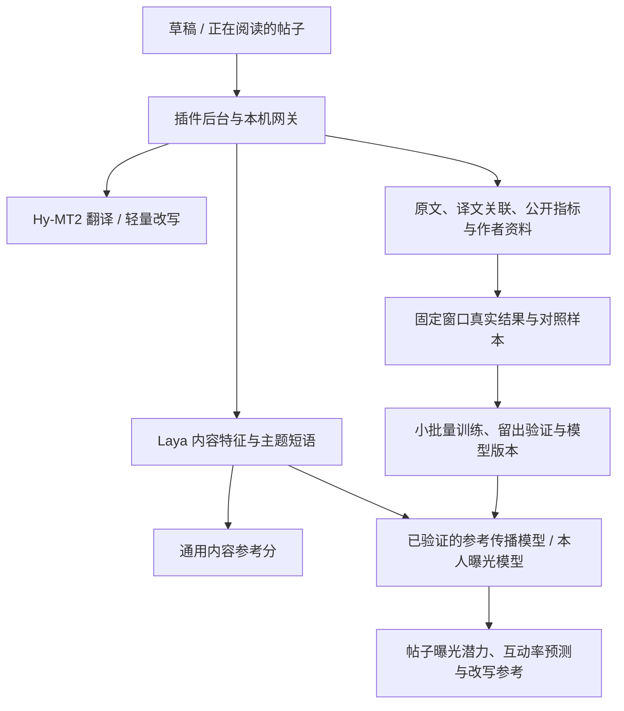

> 历史架构记录：0.6.8 起页面已移除评分、改写和学习界面，停止定时采集；已有数据保留。下文描述兼容服务模块，不代表当前页面功能。

# 帖子曝光学习（0.6.0）

目标是辅助预测待发帖子的传播表现并改进表达，不是读取 X 内部账号标签、替某位读者复现 For You 排序，或保证曝光。

## 现有链路

基础模型仍是 Laya multilingual 322M 和 Hy-MT2 1.8B。训练的是本机的小型线性统计层，未微调整个 Laya，也未自动下载英文版 421M 或接入 Jev。原有分析链路按需转中文；统一英文和更换基础决策模型仍是独立的后续选型工作。网关现在接受 Choice、Score、Noul，五项内容质量特征现改用 Score 的 0–4 档标准，按档位期望值换算后加权，Noul 仅用于主题相关性等二值判断。数值不是分类置信度，也没有经过真实曝光校准。分析流水线升级为 rubric-score-v2；缓存、训练样本和统计模型按流水线版本隔离。

## 数据分工

| 数据 | 用途 | 边界 |
| --- | --- | --- |
| 本人发布前的草稿与预测 | 冻结输入、特征、基础模型版本 | 开启对应账号的学习后才为训练保存原稿 |
| 本人已发布帖子 | 关联 Post ID、作者、发布时间与最终正文 | 作者必须一致；发布后才生成的评分不能冒充发布前预测 |
| 浏览过的帖子 | 保存公开表现及高分候选 | 高内容分只表示候选，不当作真实优质标签 |
| 自动翻译结果 | 辅助内容理解 | 以原文、Post ID、内容版本关联，不重复计算为独立样本；X/Grok 页面译文保存来源，未观察到原文则保持未知，不进入原文结果训练 |
| 作者资料 | 粉丝数、关注数及观察时间 | 只读取用户已打开页面的可见资料，不批量打开作者主页 |
| 公开指标 | 浏览、点赞、评论、转发、引用、收藏 | 不可读时为未知；缩写计数保留 approximate 标记 |

浏览数据的训练使用依据与参考学习开关单独保存。默认只记录参考，不自动将所有公开帖子用于训练。开启参考学习后，新评分记录才标记允许训练，样本保存其使用依据。普通、低内容分记录作为内部对照保留，不只训练高分正例。

## 本人发布闭环

1. 在草稿评分区展开“预测数据与学习设置”，确认自己的账号与数据使用范围，开启本地学习。
2. 对最终待发布版本评分，保存该版本的正文指纹、特征、模型版本和评分时间。
3. 用户自行点击 X 发布。插件只观察用户这一次操作；若成功提示包含本人帖子链接，就自动关联。没有识别到链接时，可粘贴链接手动关联。
4. 刚采纳改写、译文而未重新评分的版本，没有对应的发布前特征时，不纳入训练。采纳、撤销、发布关联都不自动重新请求评分或生成模型。
5. 发布后 24–26 小时采集快照。扩展每 5 分钟检查一次已打开 X 页面中的关联帖子，不打开隐藏页面、不代为发布、不调用未配置的 X API。
6. 页面未打开、帖子未在 DOM 中、浏览器或本机服务关闭时，可能采不到快照。错过窗口记录为缺失；可以导入实际在窗口内采集的历史快照，不能用更晚的累计数据冒充。
7. 正文必须与发布前版本一致。付费推广排除；浏览、点赞、评论、转发必须有精确计数。精确零曝光且互动也为零的帖子保留为对照。

页面快照可能受到 X 自身刷新或缓存影响，采集时间不等于 X 服务器测量时间。导入数据应使用真实采集时间。记录区分 page/import 来源；算法不能证明导入数值的真实性。

## 训练与预测

### 本人模型

- 同一账号、同一基础模型版本至少 30 条有效样本后尝试训练；之后每新增 5 条更新一次。
- 使用最近 200 条，按发布时间前 80% 训练、后 20% 留出验证。
- 输入为五项内容判断和主题短语的固定哈希特征；目标为 24–26 小时窗口的真实浏览表现。
- 点赞、评论、转发、收藏、引用率分别作为辅助预测目标，缺失项不补零。辅助目标也须满足样本数量和验证改善条件。
- 新版本必须在留出集上比简单基准及当前版本的平均绝对误差至少降低 5%，才启用。否则保留旧版本；可手动回退。

### 参考传播模型

- 仅使用明确允许训练、同一基础模型版本的记录，且固定窗口内有精确浏览量、可用作者粉丝数及非未来的资料快照。
- 至少 30 条、5 位作者后才尝试训练；每新增 5 条更新。拟合最多使用最近 1000 条。
- 验证既按时间留出，也排除训练中的验证作者。至少 20 条训练、5 条验证；作者隔离条件不足时继续等待，不放宽条件凑数。
- 目标是实际曝光相对作者规模的统计表现，不是模型自己给出的内容分，也不是把 X 官方系数乘到累计互动数上。
- 通过内部验证后可作为本人数据不足时的参考预测；支持版本保留和手动回退。

大数字是相对历史样本的实验性表现百分位，不是成功概率，也不是承诺曝光量。没有通过验证的模型时，显示内容参考分并注明曝光预测数据不足。所有学习后的结果在基础缓存外重新计算，账号、基础模型版本和当前学习模型不会混用。

这些阈值是初始工程设置。少量留出数据上有改善，不证明未来预测准确或修改内容能因果提升流量。模型不会读取真实读者的私人资料。

## 用户标签与受众兴趣

基于本人至少 8 条有效快照，汇总反复出现的主题短语；表现靠前帖子中重复出现的主题作为优势主题与受众兴趣线索。它们是本人公开表现的统计推测，不是 X 内部标签，也不是实际观众的人口统计。无数据时不生成画像，不推断性别、年龄、收入等。

改写可参考开启学习账号的历史主题，但仍须保留原意、事实、链接和账号，不能为了套主题编造内容。

## 公开 X 系数与本工具的区别

X 的公开排序系数作用于读者对候选帖子的预测行为概率及连续预测值，不能直接乘累计点赞、评论或转发来给作者打分。浏览量不是停留时间；关注作者的预测不是作者已有粉丝数；在核对的公开函数中未找到独立收藏系数。

本工具展示每千次浏览的互动率、作者规模、帖子年龄和观察时间。未知收藏、作者粉丝等不会被当作零。统计训练学习结果关联，不宣称复现 X 内部排序。

## 本机接口与持久化

- `/analyze`：返回通用内容特征、本人预测和参考预测；基础结果共享缓存，学习后的输出实时读取当前模型。
- `/learning/configure|status|bind|due|import|train|rollback|export`：账号开关、发布关联、定时结果、训练版本与样本导出。
- `/reference/author|report|list|configure|status|train|rollback`：公开资料、候选池、参考训练与版本。
- SQLite 在原有表之外增加 learning_*、reference_*、observed_authors 表及索引。迁移不删除历史原文、译文和缓存。
- 暂停学习保留数据与模型，但不再记录新训练草稿、训练或应用该学习模型。

## 验证范围

单元测试覆盖账号隔离、发布前时间、最终正文、精确/缺失/零计数、时间窗口、候选权限、真实结果标签、分批训练、基准比较、基础版本隔离和主题统计。浏览器测试使用模拟 X 页面、测试模型和可控时间，覆盖主动发布观察、自动关联、24 小时反馈及账号切换。未进行真实账号长期预测回测，也未证明曝光提升。
